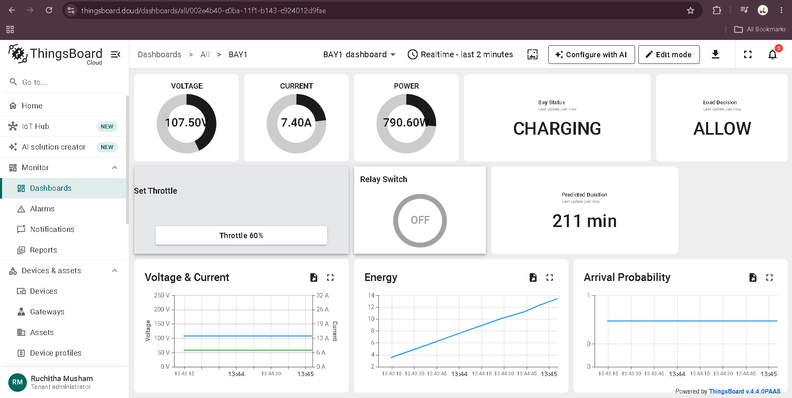
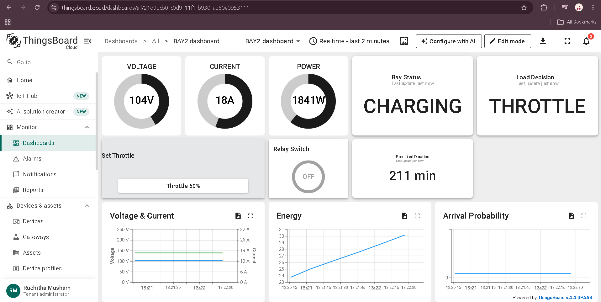
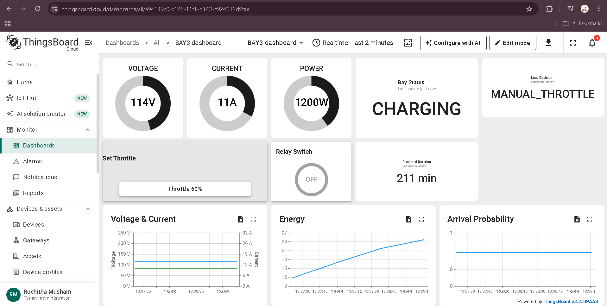
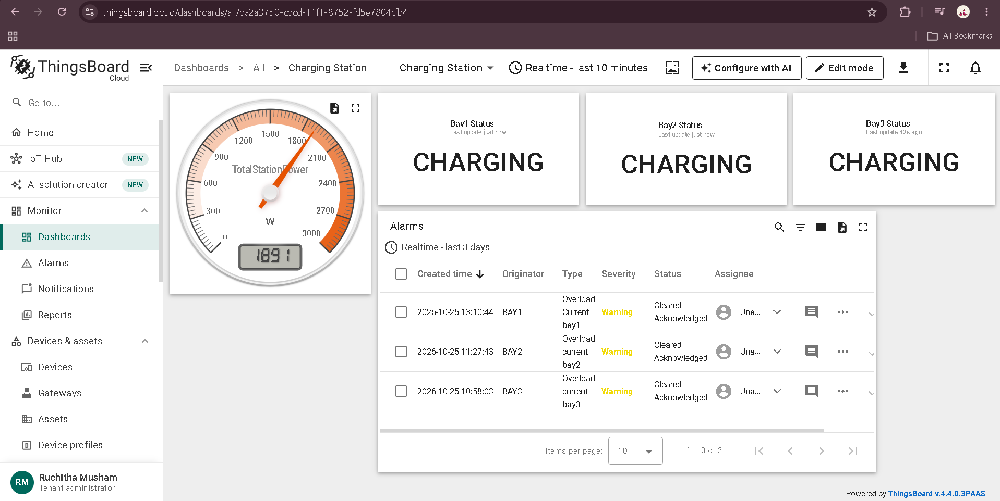
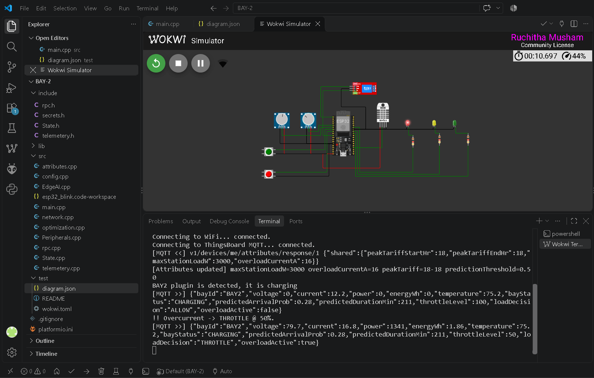

# Smart EV Charging Station Optimizer

> Built during my online internship at **Emertxe**, as an IoT industry simulation project. Emertxe provided the problem statement, the base firmware, the Edge AI model and the sessions that showed how to build the ThingsBoard side. My part was the Wokwi wiring (potentiometers, DHT11, relay and LEDs), the ThingsBoard devices, the three bay dashboards (I built each widget by hand), the station dashboard, the alarm rules, the station total, and running, testing and debugging the simulation. While testing I also fixed and extended parts of the firmware (see [Issues I found and fixed](#issues-i-found-and-fixed)).

This is a simulation of a charging station with three bays. Each bay runs on its own ESP32. It reads voltage and current (set with potentiometers) and temperature (DHT11), predicts demand with a small model running on the chip, and decides whether charging continues at full power or is throttled. All readings are sent to ThingsBoard over MQTT. Each bay is its own ThingsBoard device with its own dashboard, and a separate station dashboard shows the total power of all three bays and the alarms.

Everything runs in Wokwi with PlatformIO, so no hardware is needed.

## Why this project

When several EVs charge at the same time, the total demand can be more than the station supply can deliver. This project shows how each bay can sense its own load and react by throttling, while ThingsBoard gives a view of the whole station.

## Screenshots

**Normal charging (BAY-1):** the bay is charging at full power, and the energy chart keeps rising.



**Overload (BAY-2):** the current is above 16 A, so the bay is throttled to 50%.



**Manual throttle (BAY-3):** I sent a throttle command from the dashboard, so the decision shows `MANUAL_THROTTLE`.



**Station view:** total station power, the status of each bay, and the overload alarms from all three bays.



**Wokwi simulation:** the red LED is on and the console prints the overcurrent decision.



## How it works

```
 BAY-1 (ESP32)  ─┐
 BAY-2 (ESP32)  ─┼──  MQTT, one device token per bay  ──►  ThingsBoard Cloud
 BAY-3 (ESP32)  ─┘     ▲                                   (dashboards, alarms, history)
   │                   └── remote commands from the dashboard (RPC)
   │
   ├─ reads voltage, current, temperature
   ├─ predicts arrival probability and remaining charge time
   └─ decides ALLOW or THROTTLE (or follows a manual command)  →  relay and LEDs
```

The decision is made on the ESP32 from that bay's own readings. ThingsBoard is used to monitor the bays, send manual commands, raise alarms and keep the history. A bay sends its telemetry every 5 seconds.

## How a bay decides

These rules are in `src/optimization.cpp`. The limits come from ThingsBoard shared attributes when the bay starts (16 A and 3000 W in my setup).

**When a bay is charging:**
1. If the current is above the overload limit, the bay is throttled to **50%** and the red LED turns on.
2. Otherwise, if the bay's power is above the station power limit, the bay is throttled to **70%** when its predicted remaining time is more than 10 minutes. A bay that is almost done keeps full power.
3. Otherwise the bay is allowed at **100%**.

**When a bay is free:** during the peak-tariff hours its decision is shown as `STANDBY_EXPECTING` (a car is likely to arrive soon) or `LOW_DEMAND`.

Throttling is done by switching the relay on and off over a 2-second cycle. At 70%, the relay is on for 1.4 seconds of every 2 seconds.

## Remote control

All three bays accept two commands from their dashboard, sent as ThingsBoard RPC calls:

- **Set Throttle** (`setThrottle`) sets the throttle level, and the decision shows `MANUAL_THROTTLE`.
- **Relay Switch** (`setRelayState`) turns the bay fully on (100%) or off (0%). Off shows `MANUAL_OFF`.

A manual command pauses the automatic decision for that session, with two exceptions:

- **Overload wins.** If the current goes above the limit, the manual command is cancelled and the bay is throttled to 50%.
- **Plug-out resets it.** When the EV is unplugged, the bay goes back to automatic mode.

The Relay Switch widget only shows the last command I sent. It is not a live status light.

## Energy per session

Each bay calculates the energy delivered in the current session in Wh: power × throttle fraction × time, updated every 5 seconds. It is sent as `energyWh` and resets at every plug-in. The Energy chart on each bay dashboard shows it.

## Bay status and load decision

These are two separate values:

- `bayStatus` follows the plug: `CHARGING` while an EV is plugged in, `FREE` after it is unplugged.
- `loadDecision` is what the bay decided to do (`ALLOW`, `THROTTLE`, `MANUAL_THROTTLE`, `MANUAL_OFF`, `IDLE`, and so on).

So a bay with the relay switched off by hand still shows `CHARGING` with `MANUAL_OFF`, because the EV is still plugged in.

## Edge AI

`model.h` was provided by Emertxe. The ESP32 gives it six inputs: hour of day, day of week, whether the bay is occupied, recent average current, minutes since the session started, and the usual arrival rate for that hour. It returns the probability that a new car arrives and the estimated remaining charging time in minutes. According to the code comments, the model was trained offline on synthetic data that follows commute-hour patterns.

## LEDs in the simulation

- **Red:** overload (the green and yellow LEDs turn off)
- **Green:** bay is free (EV plugged out)
- **Yellow:** bay is charging (EV plug-in detected)

## ThingsBoard dashboards

- **Devices:** BAY1, BAY2 and BAY3 are separate devices, so the telemetry of each bay can be checked on its own in the Devices section.
- **Bay dashboards (BAY1, BAY2, BAY3):** gauges for voltage, current and power, the bay status, the load decision, the predicted charging duration, and charts for voltage and current, energy, and arrival probability. Each one also has Set Throttle and Relay Switch controls.
- **Charging Station dashboard:** the total power of all three bays, the status of each bay, and one alarm table with the overload alarms of all three bays.
- **Alarms:** each bay has an "Overload current" alarm rule (severity: Warning) that raises an alarm when the bay's current goes above 16 A and clears it when the current is back to normal.
- **Station total:** this is a ThingsBoard calculated field on the Charging Station asset. It adds the latest `power` of BAY1, BAY2 and BAY3 and saves the result as the attribute `totalstationpower`, which the gauge reads.

The dashboards are exported in the `thingsboard/` folder.

## Sample output from BAY-2

This is a real line from my simulator run, with the bay in an overcurrent situation:

```json
{
  "bayId": "BAY2",
  "voltage": 79.7,
  "current": 16.8,
  "power": 1341,
  "energyWh": 1.86,
  "temperature": 75.2,
  "bayStatus": "CHARGING",
  "predictedArrivalProb": 0.28,
  "predictedDurationMin": 211,
  "throttleLevel": 50,
  "loadDecision": "THROTTLE",
  "overloadActive": true
}
```

The console prints `!! Overcurrent -> THROTTLE @ 50%.` at the same time.

## What is in the repo

```
BAY-1/         project for bay 1
BAY-2/         project for bay 2
BAY-3/         project for bay 3
docs/          screenshots
thingsboard/   exported dashboards
```

Each bay is a separate PlatformIO project with its own ThingsBoard device token:

| File | What it does |
|---|---|
| `src/main.cpp` | main loop |
| `src/Peripherals.cpp` | sensors, relay, plug detection |
| `src/State.cpp` | shared bay state (status, throttle level, energy) |
| `src/EdgeAI.cpp`, `include/model.h` | demand prediction on the device |
| `src/optimization.cpp` | throttling decision, relay duty cycle, LEDs |
| `src/rpc.cpp` | remote commands from the dashboard |
| `src/attributes.cpp` | limits read from ThingsBoard shared attributes |
| `src/network.cpp`, `src/telemetery.cpp` | WiFi, MQTT and telemetry |
| `src/config.cpp` | WiFi and ThingsBoard settings |
| `test/diagram.json`, `test/wokwi.toml` | Wokwi circuit and simulator settings |

## How to run it

1. Install VS Code with the PlatformIO and Wokwi extensions.
2. On [thingsboard.cloud](https://thingsboard.cloud), create one device per bay and copy each device's access token.
3. In each bay folder, create `include/secrets.h` with that bay's token. This file is in `.gitignore`, so the token never goes to GitHub.
   ```cpp
   #pragma once
   #define SECRET_TB_TOKEN "your-thingsboard-device-token"
   ```
4. Open one bay folder in VS Code and build it with PlatformIO. It installs the libraries by itself (PubSubClient, ArduinoJson, DHT sensor library, Adafruit Unified Sensor).
5. Press `F1` and run **Wokwi: Start Simulator**.
6. Repeat for the other bays. I run one bay at a time, so each bay is simulated separately.
7. Import the dashboards: in ThingsBoard go to Dashboards, click **+**, then **Import dashboard**, and choose a file from `thingsboard/`. Map the entity aliases to your own devices.
8. For the station total, create the Charging Station asset and a calculated field that adds the `power` of the three bays and saves it as the attribute `totalstationpower`. The calculated field is not part of the dashboard exports.

## Issues I found and fixed

- **Dashboard stuck on old values.** The telemetry message had grown past the 256-byte packet limit of the MQTT library, so the publish failed silently. I raised the buffer size to 512 bytes and added a check on the publish result.
- **Remote control timed out.** The MQTT callback was never registered, the dashboard widget had a misspelled method name, and the command parameter arrived as a plain `true` or `false` instead of an object. I fixed all three.
- **Relay never switched during throttling.** The relay duty-cycle function existed but was never called from the main loop.
- **Manual commands fought the automatic decision.** A manual command is now respected, except that an overload cancels it.
- **Energy chart was empty.** Energy was never calculated, so I added the per-session calculation and sent it in the telemetry.

## Limitations

- It is a simulation only. Voltage and current come from potentiometers and temperature from a DHT11 in Wokwi, not from real sensors.
- Throttling does not change the simulated current or power, because the potentiometers set them. The throttle shows up in the relay switching and the energy value, not in the gauges.
- There is no station-wide control. Each bay compares only its own power with the station limit. The total power on the Charging Station dashboard is for monitoring and is not sent back to the bays.
- The station total adds each bay's last reported power, so a bay that has stopped sending still counts at its last value. I run one bay at a time, so the total on the station dashboard is built from readings taken at different moments.
- I have not measured how much peak load the throttling saves. That needs a run without optimization to compare against.
- The model and the base firmware were provided by Emertxe. The training code is not part of this repo.

## Tools used

ESP32 (DOIT DevKit v1), C/C++ (Arduino framework), PlatformIO, Wokwi, MQTT (PubSubClient), ArduinoJson, DHT11, ThingsBoard Cloud

Ruchi · [github.com/ruchithamusham](https://github.com/ruchithamusham)
